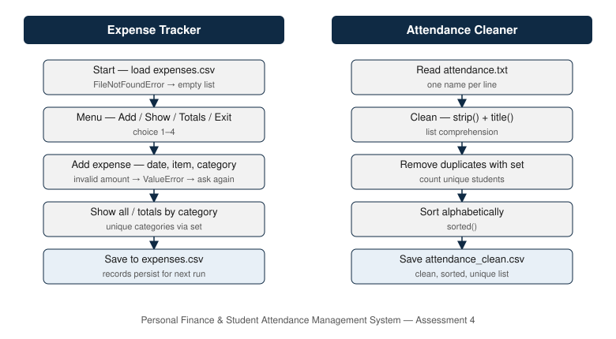

# Personal Finance & Student Attendance Management System

Assessment 4 — Python file handling, exception handling, sets and comprehensions.

Two small management tools for a training institute: an **Expense Tracker** that records daily operational expenses in a CSV file, and an **Attendance Cleaner** that removes duplicate and messy entries from student attendance records.

## Features

### Task 1 — Institute Expense Tracker (`expense_tracker.py`)

- Saves expenses in `expenses.csv` with columns `date, item, category, amount`.
- Loads previously saved expenses on startup; if the file is missing, it starts with an empty list (`FileNotFoundError` handled).
- Menu: Add New Expense · Show All Expenses · Calculate Total Expenses by Category · Exit.
- Invalid amounts are rejected and re-asked (`ValueError` handled).
- Shows all unique expense categories using a `set`.
- Every new expense is saved to the CSV file immediately, so records persist between runs.

### Task 2 — Student Attendance Cleaner (`attendance_cleaner.py`)

- Reads student names from `attendance.txt` (one name per line).
- Cleans names with `strip()` and `title()` using a list comprehension.
- Removes duplicates with a `set` and sorts names alphabetically.
- Saves the cleaned list to `attendance_clean.csv`.
- Reports the original record count, the unique student count and the cleaned list.

## Project Structure

```text
python-file-errors-assessment/
├── README.md
├── docs/
│   └── workflow.svg
├── expense_tracker.py
├── expenses.csv
├── attendance_cleaner.py
├── attendance.txt
└── attendance_clean.csv
```

## How to Run

Requires Python 3.8 or newer. No external packages needed.

```bash
# Expense Tracker (interactive menu)
python expense_tracker.py

# Attendance Cleaner (cleans attendance.txt → attendance_clean.csv)
python attendance_cleaner.py
```

## Workflow



## Sample Output

Expense totals by category (from the included `expenses.csv`):

```text
Total Expenses by Category:
Internet: 4500.00
Refreshments: 600.00
Stationery: 3050.00
Transport: 1200.00
Grand total: 9350.00
```

Attendance cleaning (from the included `attendance.txt`):

```text
Original number of records: 15
Unique student count: 8
Cleaned Attendance List:
Ahmed Khan, Ali Raza, Ayesha Ali, Bilal Hussain,
Fatima Zahra, Hassan Raza, Sana Malik, Usman Tariq
```

## Error Handling

| Situation | Handling |
| --- | --- |
| `expenses.csv` does not exist | `FileNotFoundError` caught, starts with an empty list |
| `attendance.txt` does not exist | Error message shown, program exits safely |
| Amount is not a number | `ValueError` caught, user is asked to enter it again |
| Duplicate student names | Removed with a `set` |
| Inconsistent capitalization / extra spaces | Fixed with `strip()` and `title()` |

## Technologies

- Python 3 — file handling (`open`, `csv`), exception handling (`try` / `except`), sets and list comprehensions.
